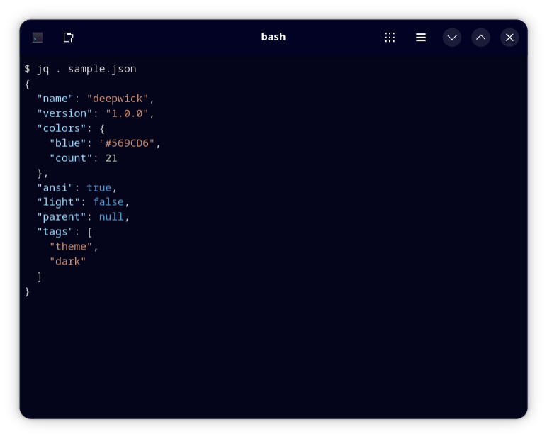

# Deepwick for jq

Deepwick colors for [jq](https://jqlang.org).

> Deepwick is an unofficial theme derived from
> [Polywick Blue](https://vscode.polywickstudio.net) by Polywick Studio (MIT).
> Not affiliated with Polywick Studio.



## Install

bash or zsh, in `~/.bashrc` or `~/.zshrc`:

```sh
source /path/to/deepwick/jq/deepwick.sh
```

fish, in `~/.config/fish/config.fish`:

```fish
source /path/to/deepwick/jq/deepwick.fish
```

## Notes

- Colors need a terminal with 24-bit color.
- Language constants (`null`, `true`, `false`) Blue, numbers Sage, strings
  Orange, object keys Light Blue, brackets and punctuation Foreground.
- Needs jq 1.8.0 or newer. jq 1.7.x rejects `JQ_COLORS` fields longer than
  12 characters, so it cannot use 24-bit colors and keeps its defaults.

Tested with jq 1.8.1.

## License

MIT. See [LICENSE](LICENSE).
